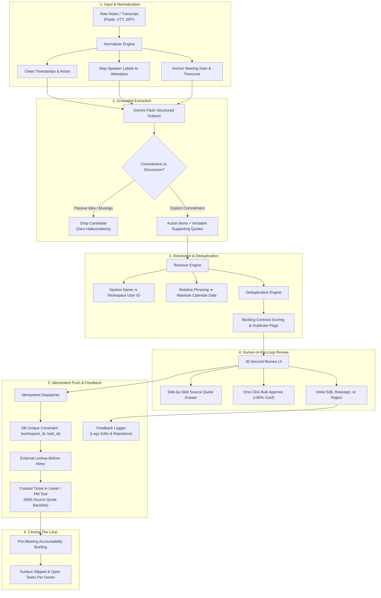

# ActionLoop: Meeting Notes → Actionable Tasks

<div align="center">

[](LICENSE)
[](https://fastapi.tiangolo.com)
[](https://nextjs.org)
[](https://aistudio.google.com)
[]()

**The last mile from unstructured meeting notes to deduplicated, owner-resolved tickets in Linear & Jira.**

[Quick Start](#-quick-start) • [Pipeline Architecture](#-pipeline-architecture) • [Evaluation Benchmark](#-evaluation-benchmark) • [GitHub Topics & Tags](#-tags--topics)

</div>

---

## 🌟 The Core Problem

Extracting action items from transcripts is a commodity (Otter, Fireflies, Fathom all do it). The real problem teams actually suffer from is the **last mile**:
- **Hallucinated Tasks**: Models invent tasks from casual banter or brainstorming discussions.
- **Ambiguous Ownership**: Spoken first names (*"Priya"*, *"Alex"*) aren't mapped to verified user IDs in the issue tracker.
- **Floating Due Dates**: Relative dates (*"by Wednesday EOD"*, *"next sprint"*) aren't resolved into concrete calendar dates based on meeting timezones.
- **Duplicate Backlog Sprawl**: The team talks about an ongoing issue and the tool blindly creates a duplicate ticket.
- **Lack of Trust**: Nobody pushes AI output to Linear/Jira without an efficient human-in-the-loop review.
- **No Follow-Through**: Once pushed, tickets are forgotten until someone asks *"whatever happened to that item from two weeks ago?"*

---

## 🚀 Architecture & Pipeline Flow

ActionLoop operates as a **deterministic 6-stage pipeline with strict LLM structured output contracts**, avoiding unpredictable free-roaming agents:



### Pipeline Breakdown

| Stage | Operation | Guarantees / Guardrails |
| :--- | :--- | :--- |
| **1. Normalize** | Cleans transcripts, extracts speakers, anchors meeting timezone | Deterministic cleanup; formats raw VTT/SRT into clean speaker turns |
| **2. Extract** | Gemini Flash with `responseSchema` JSON validation | Requires verbatim `supporting_quote` for every item; rejects idle discussion |
| **3. Resolve** | Maps names (*"Priya"*) to user IDs; computes dates (*"by Friday"*) | Flags duplicate first names as `is_ambiguous`; leaves unassigned if unknown |
| **4. Dedupe** | Jaccard token overlap + Levenshtein contrast penalties | Flags duplicate candidates against active open backlog tickets |
| **5. Review** | 30-second Next.js review screen | Rapid review with quote inspection drawer & one-click bulk approval |
| **6. Push** | Dispatches tickets to Linear / Jira | DB-level unique constraints + external lookup-before-retry pattern |
| **7. Close Loop**| Pre-meeting accountability recaps | Surfaces uncompleted and slipped items per person before the next meeting |

---

## ✨ Key Features

- **Quote-Grounded Extraction**: Every task candidate requires a verbatim `supporting_quote` directly from the transcript. If the quote doesn't support the commitment, it is rejected.
- **Strict Separation of Discussion vs. Action**: Casual musings (*"We should probably redesign onboarding next quarter"*) are filtered out with zero hallucinated tasks.
- **Ambiguity Guardrails**: Multiple attendees with the same first name (e.g. Alex Chen vs. Alex Rivera) are automatically flagged as `is_ambiguous` rather than guessing wrong.
- **Deep Idempotency**:
  - Database-level unique constraint on `(workspace_id, task_id)`.
  - Lookup-before-retry pattern: if an API call drops mid-batch, subsequent retries query Linear by external backlink before attempting re-creation.
- **Multi-Tenant SaaS Isolation**: All queries enforce strict `workspace_id` tenant scoping. Unauthorized cross-tenant requests yield clean 404 responses.
- **Fernet Token Encryption with Key Rotation**: OAuth tokens are encrypted at rest using AES-128-CBC with HMAC-SHA256 (`MultiFernet`), allowing seamless zero-downtime key rotation.
- **Pre-Meeting Accountability Briefings**: Surfaces open and slipped action items per owner before the next meeting to close the execution loop.

---

## 🛠️ Tech Stack

| Layer | Technology |
| :--- | :--- |
| **Backend** | Python 3.11+, FastAPI, Pydantic v2, SQLite / PostgreSQL |
| **Frontend** | Next.js 14 (App Router), React 18, Tailwind CSS, Lucide Icons |
| **AI / LLM** | Google Gemini Flash (Latest / 2.5 / 3.5) with strict JSON Schema (`responseSchema`) |
| **Cryptography**| `cryptography.fernet.MultiFernet` (AES-128-CBC + HMAC-SHA256) |
| **Integrations**| Linear GraphQL API + Mock Sandbox Provider (zero external keys needed for local testing) |

---

## ⚡ Quick Start

### 1. Clone & Setup Environment

```bash
# Clone the repository
git clone https://github.com/nizaalkhot/mini-saas-meeting-notes-into-tasks.git
cd mini-saas-meeting-notes-into-tasks

# Copy environment template
cp .env.example apps/api/.env
```

Open `apps/api/.env` and insert your [Google AI Studio Gemini API Key](https://aistudio.google.com/app/apikey):
```env
GEMINI_API_KEY="your_api_key_here"
```

### 2. Start the FastAPI Backend

```bash
cd apps/api
pip install -r requirements.txt
uvicorn main:app --reload --port 8000
```
- Interactive API Documentation: `http://localhost:8000/docs`

### 3. Start the Next.js Frontend

```bash
cd apps/web
npm install
npm run dev
```
Open `http://localhost:3000` in your browser.

> [!TIP]
> **Need to run on a different port?**  
> Simply pass `-p <port>`:
> ```bash
> npm run dev -- -p 3001
> ```

---

## 🧪 Automated Testing & Benchmark

### Run the Backend Test Suite
ActionLoop features comprehensive unit, failure-mode, and cross-tenant isolation tests:

```bash
cd apps/api
python -m pytest tests -v
```
All **15/15 tests** pass:
- Direct model extraction with structured schemas
- Cross-tenant multi-tenancy isolation (404 enforcement)
- AES-128-CBC Fernet encryption & zero-downtime key rotation
- Timezone boundary adjustments (e.g. Friday evening *"tomorrow"*)
- Name collision ambiguity resolution
- Deep idempotency (DB constraint + lookup-before-retry)
- Semantic deduplication with contrast penalties

### Run the Evaluation Benchmark
Evaluate precision, recall, and rejection of passive discussion across 40 real-world transcripts:

```bash
# Via CLI
cd apps/api
python -c "from routers.eval import run_golden_benchmark; from database import init_db; init_db(); import json; print(json.dumps(run_golden_benchmark(), indent=2))"
```
Or open the web dashboard at `http://localhost:3000` and click **"Run Model Benchmark"**!

---

## 🏷️ Tags & Topics

When configuring your GitHub repository settings, use the following tags and topics:

`actionloop` • `meeting-notes` • `task-extraction` • `linear-app` • `gemini-api` • `llm` • `structured-outputs` • `fastapi` • `nextjs` • `saas` • `productivity` • `ai-agents` • `fernet-encryption` • `multi-tenant` • `pydantic`

---

## 📦 Release Information

- **Release**: `v1.0.0`
- **Initial Release Date**: November 2026
- **License**: MIT
